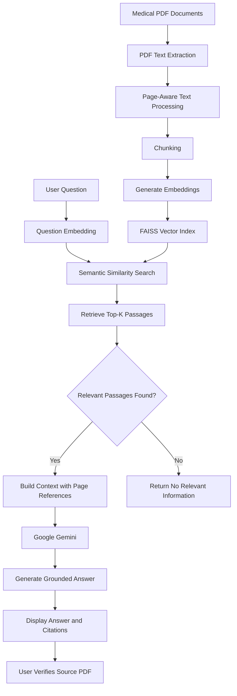

# RxReveal

**Answers from medical PDFs, with the page numbers to check them.**

RxReveal answers plain-English questions about medical PDFs. Each answer is grounded in passages it retrieves from the document and lists the pages they came from, so you can verify it instead of trusting it. It runs locally, in Docker, or in the cloud.

Originally developed from a Kaggle notebook for the Google × Kaggle Gen AI Intensive Course Capstone 2025Q1, this version is a complete application that can run locally in VS Code, in Docker, or on a compatible cloud platform.

**Core technologies:** Python, Streamlit, Google Gemini, embeddings, FAISS, RAG, Docker, pytest, and GitHub Actions.

## Important: Patient Data and Privacy

The text of your documents is sent to Google twice when using Gemini embeddings: first to create the search index and later as context for answering questions.

Google's terms and data practices depend on the API service and plan. The project documentation warns that data submitted through the free, unpaid Gemini API tier may be used to improve Google's products and may be reviewed by human reviewers.

- Use synthetic or public documents with the free tier.
- Do not upload sensitive, confidential, or personally identifiable patient records without appropriate safeguards and suitable data agreements.
- For real patient records, evaluate a paid Gemini service or Vertex AI with the appropriate contractual and privacy protections.
- Follow applicable laws and regulations, including HIPAA where relevant and India's Digital Personal Data Protection (DPDP) framework where applicable.

See the [Gemini API Terms](https://ai.google.dev/gemini-api/terms) before using the service with sensitive information.

## How It Works

RxReveal uses a RAG pipeline to retrieve relevant information from PDF documents before generating an answer.

```text
Medical PDF documents
        |
        v
PDF text extraction with page information
        |
        v
Text processing and chunking
        |
        v
Gemini embeddings
        |
        v
FAISS vector index
        |
        v
User asks a question
        |
        v
Question embedding and semantic search
        |
        v
Retrieve top relevant passages
        |
        v
Google Gemini generates a grounded answer
        |
        v
Answer with source and page citations
```

### Key Components

- **PDF ingestion:** Extracts document text and preserves page references.
- **Chunking:** Splits patient records by `Patient <n>:` headings where applicable. Other documents are divided into paragraphs of approximately 1,200 characters.
- **Embeddings:** Converts document chunks and questions into vector representations using Gemini embeddings.
- **Vector search:** Uses FAISS and cosine similarity to find relevant passages.
- **Retrieval:** Selects the top matching passages and filters out results below a configured minimum score.
- **Answer generation:** Passes retrieved context to Gemini to generate a concise answer.
- **Source citations:** Displays references such as `[1]` and `[2]` associated with relevant passages and page numbers.
- **Local embedding option:** Supports a MiniLM embedding backend for local semantic search.

If no sufficiently relevant information is found, the application is designed to indicate that the documents do not provide a relevant answer.

## End-to-End Workflow

The following diagram describes the complete application flow from document ingestion to answer generation and deployment.



### Step 1: Load Documents

The application reads PDF documents from the `data/` directory or from the browser upload interface when uploads are enabled.

The repository includes a synthetic sample document for demonstration.

### Step 2: Extract Text

The ingestion module extracts text from the PDF and retains page information for citation purposes. Scanned PDFs may require OCR if their text is not directly extractable.

### Step 3: Split Documents into Chunks

The extracted text is divided into searchable sections.

- Patient records are split using `Patient <n>:` headings.
- A patient record can remain in one chunk even when it crosses a page boundary.
- Other documents are split into paragraphs of approximately 1,200 characters by default.

### Step 4: Generate Embeddings

Each chunk is converted into a vector using the configured embedding backend. These vectors represent semantic information and support meaning-based retrieval.

The default backend uses Gemini embeddings. An optional local MiniLM backend is available.

### Step 5: Build the FAISS Index

FAISS stores the vectors and supports similarity search. The index is built when needed, and the application can rebuild it when relevant settings change.

### Step 6: Accept a User Question

The user enters a question in the Streamlit interface about the available documents.

For example:

> What information does the document provide about Patient 1?

### Step 7: Retrieve Relevant Passages

RxReveal embeds the question and searches the FAISS index for similar document chunks.

- `RX_TOP_K` controls how many passages are considered.
- `RX_MIN_SCORE` sets the minimum similarity score for retaining a passage.

### Step 8: Generate the Answer

The retrieved passages are sent to Google Gemini as context. The model generates an answer grounded in the supplied information.

### Step 9: Show Citations

The interface displays the answer with references to relevant passages and page numbers, allowing users to verify the information in the original PDF.

### Step 10: Test and Deploy

The application can be run locally with Streamlit, packaged with Docker, tested with pytest, and built through the configured GitHub Actions workflow. It can also be deployed to Google Cloud Run or another compatible container platform.

## Features

- Medical PDF question answering.
- Semantic retrieval using vector embeddings.
- FAISS-based similarity search.
- Context-grounded Gemini responses.
- Page-aware source citations.
- Configurable retrieval settings.
- Optional local MiniLM embedding backend.
- Streamlit user interface.
- Docker and Docker Compose support.
- Automated tests and Docker build through GitHub Actions.
- Configurable password protection and PDF uploads.

## Technology Stack

| Category | Technology |
|---|---|
| Language | Python |
| User interface | Streamlit |
| Large language model | Google Gemini |
| Embeddings | Gemini embeddings or local MiniLM |
| Vector search | FAISS |
| Document processing | PDF text extraction |
| Testing | pytest |
| Containerization | Docker, Docker Compose |
| CI | GitHub Actions |
| Cloud deployment | Google Cloud Run or compatible platforms |

## Project Structure

```text
rxreveal/
├── app.py
├── rxreveal/
│   ├── config.py
│   ├── ingest.py
│   ├── index.py
│   ├── llm.py
│   ├── rag.py
│   └── build_index.py
├── data/
│   └── synthetic sample documents
├── scripts/
│   ├── make_sample_pdf.py
│   └── start.sh
├── tests/
├── notebooks/
├── .streamlit/
│   └── config.toml
├── .github/
│   └── workflows/
│       └── ci.yml
├── Dockerfile
├── docker-compose.yml
└── README.md
```

| File or directory | Purpose |
|---|---|
| `app.py` | Streamlit application interface |
| `rxreveal/config.py` | Reads configuration from environment variables |
| `rxreveal/ingest.py` | PDF reading and text chunking |
| `rxreveal/index.py` | Embedding generation and FAISS indexing |
| `rxreveal/llm.py` | Gemini client integration |
| `rxreveal/rag.py` | Retrieval and answer generation |
| `rxreveal/build_index.py` | Builds the document search index |
| `data/` | PDF documents used by the application |
| `scripts/` | Utility and container startup scripts |
| `tests/` | Automated tests |
| `notebooks/` | Original Kaggle notebook |
| `.github/workflows/ci.yml` | Automated testing and Docker build workflow |

## Getting Started

### Prerequisites

Install:

- Python 3.11 or 3.12.
- Visual Studio Code with the Python extension.
- Git.
- Docker Desktop if you want to use containers.
- A Gemini API key for the default embedding and generation backends.

### 1. Clone the Repository

```bash
git clone https://github.com/Satya1729-bil/rxreveal.git
cd rxreveal
```

Ensure you are in the project directory containing `app.py` and the `rxreveal/` package.

### 2. Open the Project in VS Code

Open VS Code, select **File → Open Folder**, and choose the project directory.

Open a terminal using **Terminal → New Terminal**.

### 3. Create a Virtual Environment

**Windows PowerShell:**

```powershell
python -m venv .venv
.venv\Scripts\Activate.ps1
```

**macOS or Linux:**

```bash
python3 -m venv .venv
source .venv/bin/activate
```

### 4. Install Dependencies

```bash
pip install -r requirements-dev.txt
```

### 5. Configure the Gemini API Key

1. Create a Gemini API key in [Google AI Studio](https://aistudio.google.com/apikey).
2. Copy `.env.example` to `.env`.
3. Add your key to the `.env` file:

```dotenv
GEMINI_API_KEY=your_gemini_api_key_here
```

Replace the placeholder with your actual key. Keep `.env` out of Git and never commit API keys to the repository.

### 6. Add Documents and Build the Index

The repository already includes `data/sample_medical_records.pdf`, a synthetic file with 30 fake patients. To use your own documents, put PDF files in `data/`, then build the index:

```bash
python -m rxreveal.build_index
```

The app also builds the index on first start if it is missing.

### 7. Run the App

```bash
streamlit run app.py
```

Open http://localhost:8501 in your browser.

### 8. Run the Tests

```bash
pytest -q
```

The tests use a fake embedder and a fake model, so they need no API key. GitHub Actions runs them on every push.

## Run with Docker

```bash
docker compose up --build
```

Docker Compose reads `.env`, keeps your documents in `./data`, and serves the app at http://localhost:8501.

## Deploy for Free on Streamlit Community Cloud

1. Sign in at [share.streamlit.io](https://share.streamlit.io) with your GitHub account.
2. Choose **Create app**, then pick this repository, the `main` branch, and `app.py` as the main file.
3. Open **Advanced settings**, choose Python 3.11 or 3.12, and paste your secrets:

```toml
GEMINI_API_KEY = "your_gemini_api_key_here"
RX_ALLOW_UPLOAD = "false"
```

4. Deploy. On first start, the app indexes the sample PDF in `data/`.

Streamlit passes top-level secrets to the app as environment variables, which is how RxReveal reads its settings. Turning uploads off keeps a public demo on the fake sample data, so nobody sends real patient records through your free-tier key. Add `APP_PASSWORD` as well if you want to limit who can use the demo.

## Evaluation

`eval/questions.json` holds 17 test questions about the sample PDF. Their answer key comes from the same seeded generator that made the PDF (`scripts/make_sample_pdf.py`), and `tests/test_evaluate.py` checks the key against the generator on every CI run.

The questions cover three kinds of request:

- **Single-patient lookups (8):** for example, "What treatment did Victor Reed receive?"
- **List questions (6):** for example, "List the names of all patients with pneumonia." These need every matching record, so they also test retrieval.
- **Questions the documents cannot answer (3):** for example, "What is Maria Ortiz's blood type?" The correct answer is to say so.

Run it with your Gemini key set:

```bash
python -m rxreveal.evaluate
```

It prints a scored report and saves it to `eval/results.md`. Add `--top-k 10` to see how list answers change when more passages are retrieved.
